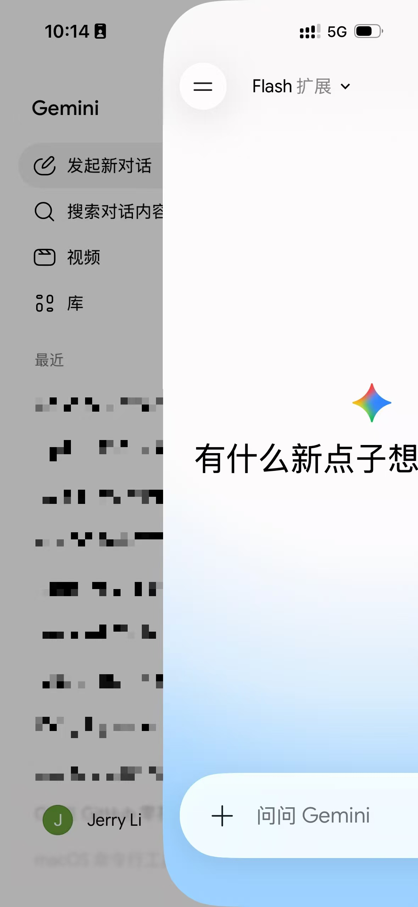

HardBack - 一款纯净的本地化漫画阅读器。启动即见书架，让你的数字阅读回归纯粹。

查看技术栈

# 技术栈
- **语言与UI框架：** Swift, SwiftUI(iOS 17+)。支持iOS、iPadOS，兼容性好。
- **本地数据存储：** SwiftData。用于存储漫画元数据（名称、路径、阅读进度、所属书架、收藏状态、*SortIndex* 等）
- **图片缓存与加载：**`Kingfisher`或`Nuke`（第三方库）。控制图片预加载页数，（特别地，定义长图判断函数，长图*视UI尺寸向下采样*）防止内存溢出。
- **文件格式解析：**
	- **ZIP/CBZ：**`ZIPFoundation`（第三方库），实现边解压边读取/解压至沙盒缓存。
	- **PDF：** 苹果原生`PDFKit`。
	- **RAR/CBR：** 需要桥接C/C++ 库（如`Unrarkit`）。
	- **EPUB：**`EPUBKit`等，涉及HTML/CSS渲染。
- **网络存储：**`AMSMB2`等。
- **网盘：** 各主流网盘API。
- **内嵌浏览器：**`WKZombie`、`WKWebView`、`SwiftSoup`、`SDWebImage`、`ZWHTMLImage`、`URLSession`。用于浏览漫画网站，自动缓存、抓取图片文件下载到本地。

# 界面与交互
### 1.导航框架
采用全局侧滑栏drawer，参考Gemini App。但是，侧滑栏层级应置于**主页上方**。

View Gemini App Slider Tab 

- **侧滑栏包含的元素：**
	- 导航：主页、书架（列表）、收藏夹。
	- 底部：新建书架、应用设置。
- **首页加载：** 默认停留在“主页”，侧滑栏收起。
> 注意：侧滑栏只在主页、书架、收藏夹页面可被触发。在所有弹出操作、应用设置页面以及阅读器页面要彻底禁用触发手势。
### 2.漫画浏览层（主页/书架/收藏夹）
浏览层的漫画均以瀑布流呈现。
- **视图模式选择：** 网格、列表两种形式。列表模式下显示漫画封面、元数据和收藏按钮。

查看示例

（图片来自[AniShelf](https://github.com/samuelhe52/AniShelf)）

---
|网格视图|列表视图|
|:---:|:---:|
|||

- **界面元素分布：**
	- 左上：当前书架的漫画总数（书架、收藏夹界面）
	- 右上：导入漫画按钮。
	- 底部工具栏：试图选择切换、搜索功能、筛选/排序控制。
	> 排序方式：导入时间、最近阅读、名称、大小、***无***。 `无`是手动排序。在应用设置中存在`重置手动排序` 的按钮设置项，点击后会**按照选定的排序方式重置所有漫画的`SortIndex`**。
	
	> 收藏夹、主页不支持筛选/排序。
- **交互：**
	- 长按漫画：呼出上下文菜单，包含更换所属书架、重命名、收藏、删除。
	- 自定义排序时可长按拖拽移动。
	- 支持多选，批量操作。
### 3.漫画阅读器
- **阅读模式：**
	- 左右翻页：有翻页动画，支持翻页方向（←/→）设置，双页视图开关，自动翻页菜单（关闭/3秒/5秒/10秒/自定义时间间隔）。
	- 瀑布流阅读：支持单页（上下翻页）/拼接切换。自动下滑菜单（同上）。
- **射线检测：**
	|||
	|:---|:---|
	|**左右翻页**|- 左右两侧：前后页翻页 - 中间：呼出控制菜单 - 左右滑动：翻页|
	|**瀑布流**|- 点击屏幕任意位置呼出控制菜单 - 上下滑动：翻页 - 拼接模式时，向下滑动也可呼出控制菜单|
- **控制菜单：**
	- 顶部：左上退出阅读返回主页面；右上提供收藏和折叠的菜单栏（重命名、移动）
	- 底部：单话切换器、阅读模式设置。
	- 退隐机制：
		|||
		|:---|:---|
		|**左右翻页**|- 点击控制菜单以外的任意位置 - 控制菜单激活时***不支持*** 滑动翻页|
		|**瀑布流**|- 点击控制菜单以外的任意位置 - 拼接模式时，向上滑动自动隐藏|
> 在左右翻页、上下翻页模式下，激活控制菜单时滑动操作会***隐藏控制菜单***，而非翻页。
- **图片放大：**
	- 缩放方式：捏合、双击。
	- 单指拖拽移动。
	- 放大状态下，不支持滑动操作，仅支持单击呼出控制菜单。

---
**新用户引导** - 书架为空状态时，引导用户点击右上角或长按空白处导入漫画。

# 文件管理
### 1.功能
- **导入与存放：** 本地导入，拷贝存放至App 沙盒。文件/文件夹名称即漫画名称，App 内重命名将直接修改文件名称。
> 导入自动归并：若用户在根目录下批量导入含相同字段的漫画，弹窗询问是否合并为一个漫画，允许用户命名合并后的漫画。
- **格式支持：** 支持zip, pdf, epub, png, jpg, rar 等，支持压缩包解密。
- **冲突处理：** 导入文件出现重名时，弹出对话框询问用户操作（覆盖/保留两者重命名）
> 若用户在重命名前退出App，则自动将新文件名称后添加`日期+时间`后缀。
### 2.数据组织
- **单一归属：** 每本漫画均以“书架”为基本单元进行组织，同一本漫画同时只能处于一个常规书架内。
- **默认书架：** 初始化存在“默认书架”与“收藏夹”。默认书架允许重命名。
- **收藏夹逻辑：** 收藏夹作为特殊的虚拟书架，与常规书架存在交叉关系。
- **书架管理：** 用户可以任意新建书架，默认书架不支持更改。
- **文件层级：** 根目录下的**文件/文件夹即一部漫画**，其子文件夹或文件**按排序规则映射为章节/卷**，不递归读取子文件夹的子文件夹。*禁止套娃*。
- **缓存管理：** 将解压的图片存入沙盒caches 文件夹。边阅读变解压（流式解压）基于异步线程处理，因此用户退出阅读时需要检测、清空缓存。
> 同时，暂不支持“在书架内新建书架分区”的套娃行为。

# 路标
1. **UI骨架：**
	- 完成Slider 设计封装，支持切换主页/书架/应用设置界面。
	- 完成底部工具栏、书架瀑布流占位视图布局。
2. **实体定义：**
	- 敲定关键实体的字段定义。`名称`、`导入时间`、`阅读进度`、`最后阅读时间`，以及`存储类型（0=本地，1=smb）`，`远端相对路径`等暂时冗余的字段。
	- 自定义排序模式下，拖拽结束仅更新被拖拽项及区间内受影响项的`SortIndex`，且批量更新必须在后台私有上下文中执行，保存完成后在主线程合并刷新。
3. **数据：**
	- 定义SwiftData 实体（漫画/书架）。
	- 接入fileImporter，将测试文件夹导入App 沙盒，并在浏览层显示元数据。
4. **点读机：**
	- 搭建基础阅读器界面，实现翻页的手势响应逻辑。
	- 完成多文件类型的解析。实现“导入文件”->“后台解压至caches”->“阅读器异步渲染缓存图片”->“退出清空缓存”闭环。
5. **完善与重构：**
	- 补充书架管理逻辑、阅读器控制菜单。
	- 实现`NAS、网盘、iCloud` 等复杂功能的接入。
- **可选：**
	- 内嵌浏览器自动下载网页漫画。
	> 仅作为技术探索，正式版是否上架视App Store 审核政策以及版权风险而定。